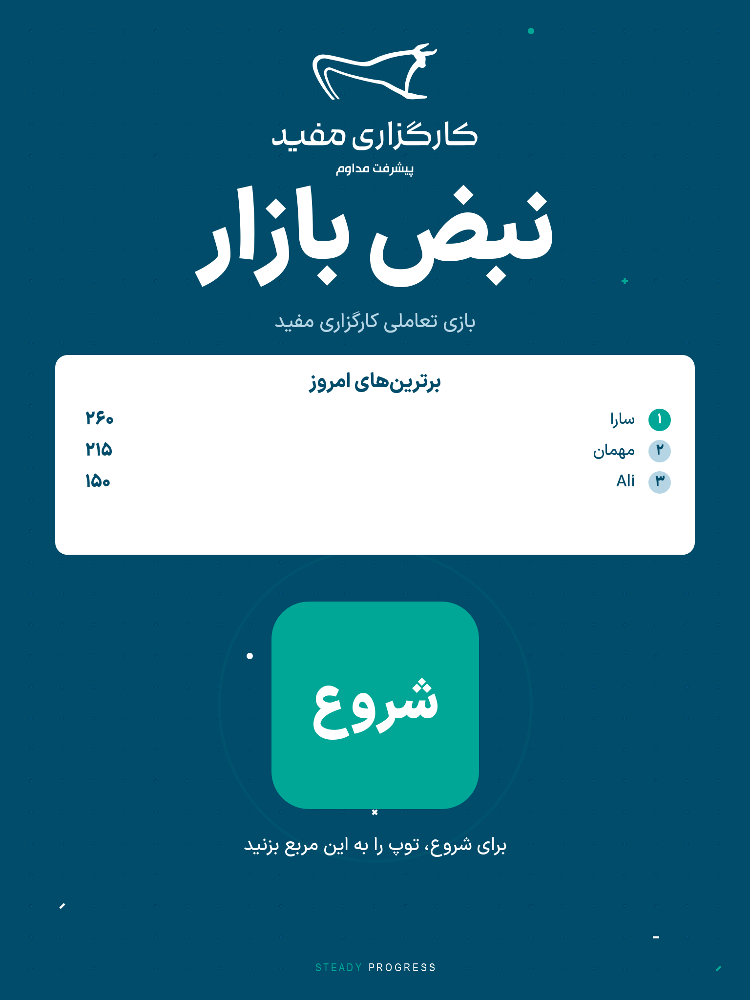
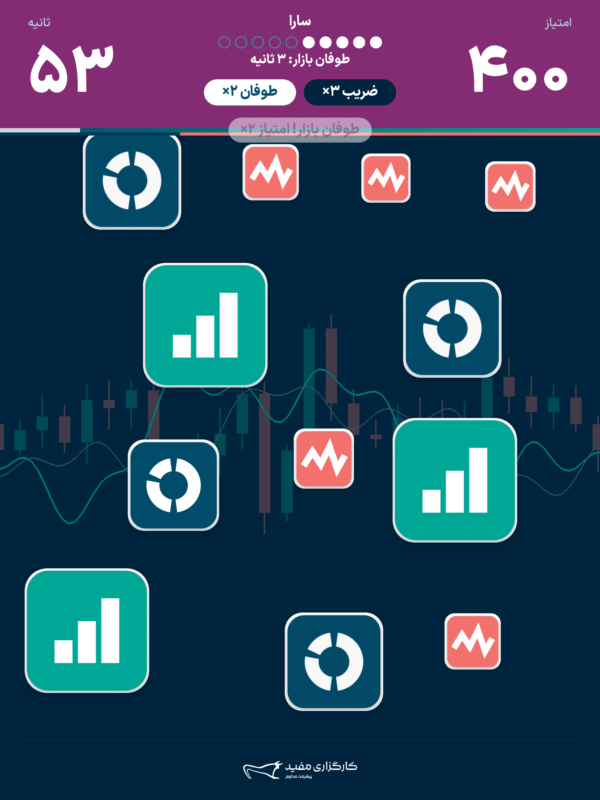
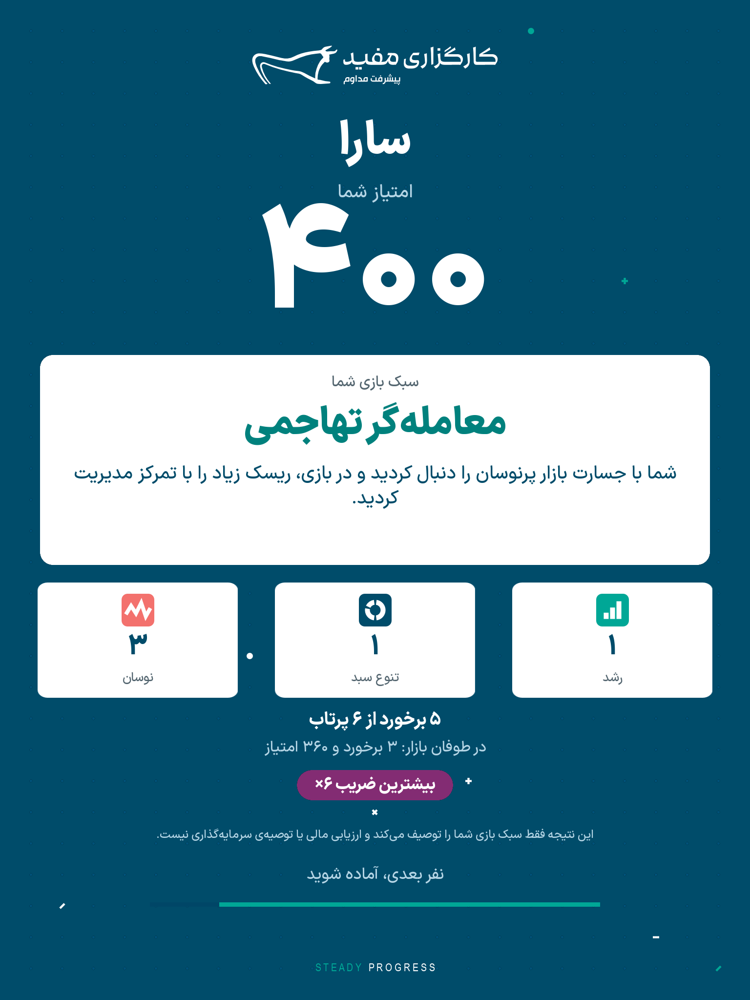
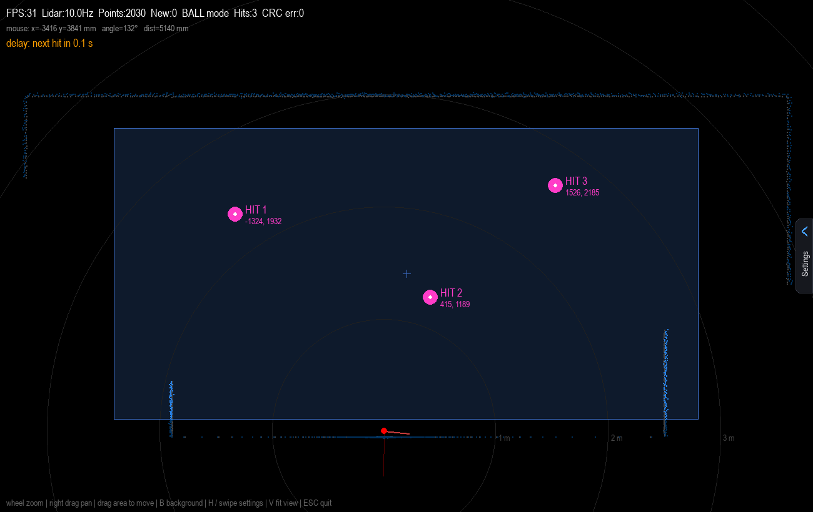
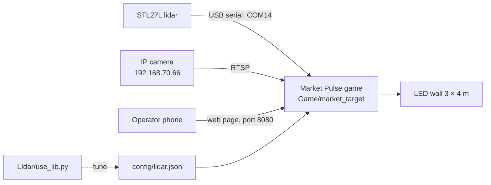

# mofid_game · Market Pulse (نبض بازار)

An interactive ball-throwing game for a Mofid Securities (کارگزاری مفید) LED wall. Players
throw soft balls at moving coloured boxes on a 3 × 4 m wall. An **STL27L lidar** finds where
each ball hits, and an **IP camera** records a replay of the player for the results card.

<p align="center">
  
  
  
</p>

<p align="center"></p>

## What's in this repo

| Folder | What it is | Read more |
|---|---|---|
| [`Game/market_target`](Game/market_target) | **The game.** Python + pygame-ce: rules, Persian screens, brand artwork, settings page, operator phone page, player replay, lidar input. | [Game README](Game/market_target/README.md) |
| [`LIdar`](LIdar) | **Lidar tool.** STL27L reader, ball/touch detection, tuning window with settings panel, raw test program, 13 Hz ESP-12F mod. | [LIdar README](LIdar/README.md) |
| [`camera`](camera) | **Camera tools.** Low-latency RTSP viewer with person detection (YOLOv4-tiny), and a reader for the camera's web-player stream. | [`camera_viewer.py`](camera/camera_viewer.py), [`ws_camera.py`](camera/ws_camera.py) |

## How the parts fit together



- **Lidar → game.** The game reads the lidar itself (`input.sources` includes `"lidar"`). Its
  detection is the one from `LIdar/use_lib.py`, copied into `market_pulse/input/lidar/`. The
  tuning values live in `Game/market_target/config/lidar.json`. Tune them with the game closed:

  ```bash
  cd LIdar
  python use_lib.py --settings ../Game/market_target/config/lidar.json --no-osc
  ```

  Other sensors can send hits as UDP JSON (port 9100) or TUIO (port 3333).
- **Camera → game.** The game reads the camera's RTSP main stream the same way
  `camera/camera_viewer.py` does. The results card shows a replay of one of the player's
  scoring hits that ends on a still of their face.
- **Phone → game.** The operator's phone opens a web page served by the game to type names,
  start rounds and download results.

## Quick start

**Game** (Python 3.10+, Windows 11 tested):

```bash
cd Game/market_target
python -m venv .venv
.venv\Scripts\python -m pip install -r requirements.txt
.venv\Scripts\python main.py --windowed --simulate
```

`--simulate` uses mouse clicks instead of balls. On the wall, run `python main.py`
(full screen, sensor input). Use **pygame-ce**, not `pygame`, so Persian text is shaped.

**Model file.** The player replay needs `yolov4-tiny.weights` (24 MB, not in the repo) in
`Game/market_target/models/`. Download it once from the repo root:

```bash
curl -L -o Game/market_target/models/yolov4-tiny.weights https://github.com/AlexeyAB/darknet/releases/download/darknet_yolo_v4_pre/yolov4-tiny.weights
```

`camera/camera_viewer.py` downloads its own copy into `camera/models/` the first time it runs.

**Lidar tool:**

```bash
cd LIdar
pip install -r requirements.txt
python use_lib.py
```

**Camera viewer:**

```bash
cd camera
pip install -r requirements.txt
python camera_viewer.py
```

## Hardware

| Part | Setup |
|---|---|
| LDROBOT STL27L lidar | USB-serial adapter (CP210x), `COM14`, 921600 baud. Laser plane 12–15 cm in front of the wall, lidar near the floor. |
| IP camera | `192.168.70.66` on its own Ethernet adapter; the PC needs `192.168.70.200/24` on that adapter. RTSP `/media/live/1/1` (1920×1080) and `/media/live/1/2` (640×360), no login. |
| LED wall | 3 × 4 m, game canvas 1536 × 2048. |
| PC | Windows 11, Python 3.10. |

## Not in this repo

- `market_target.rar` and `market_pulse_full_project.zip`: archives of this folder (too big for GitHub).
- `Game/market_target/.venv`, `build/`, `dist/`: rebuild them. `tools/build_exe.py` makes `dist/MarketPulse.exe`.
- `Game/market_target/logs/` and `data/results.jsonl` (player results).
- `yolov4-tiny.weights` (24 MB public model, see **Model file** above).
- Five design screenshots that show a real player's photo or real names (listed in `.gitignore`).
